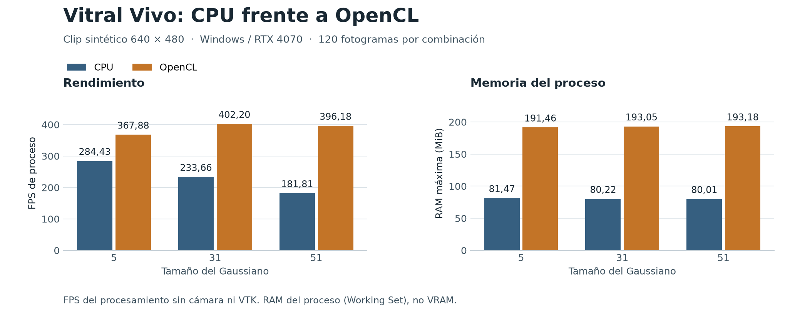

# Vitral Vivo — Parte I

## Introducción y problema

Vitral Vivo convierte video en un mosaico de triángulos. El problema es conservar los contornos importantes sin que la malla cambie entre fotogramas, y comparar CPU con OpenCL usando el mismo algoritmo. Se implementó en escritorio (C++ y OpenCV/VTK) y Android (Kotlin y C++ por JNI). Ambas aplicaciones comparten el núcleo `Principal.hpp`.

## Propuesta y esquema

```text
Fotograma BGR ─┬─ Color original → mapa de color ───────────────────┐
              └─ Gris → Mediana → CLAHE → Gaussiano                │
                        → Sobel + kernel propio → máscara ────────┤
                                                                   ↓
                                   Malla fija → Vitral Vivo → vista
```

La mediana reduce ruido impulsivo, CLAHE ajusta el contraste local y el Gaussiano suaviza antes de calcular bordes. Sobel combina las magnitudes horizontal y vertical. El kernel propio tiene centro positivo y pesos negativos en los vecinos. Sus coeficientes suman cero; una región uniforme se cancela. La magnitud de su respuesta se multiplica por 12 antes de mezclarla con Sobel: `E = (1−w)·S + w·H`. `S` es la respuesta de Sobel, `H` la del kernel calibrado y `w` el peso del kernel.

La máscara resultante hace más visibles las subdivisiones sin mover los vértices. Los triángulos toman el color del fotograma original. VTK actualiza el plano de video dentro de un marco de cuatro barras con grosor. Android conserva original a la izquierda, vitral a la derecha y selección de etapas.

## Requisitos y verificación de la Parte I (18 de noviembre de 2026)

- **Escritorio:** compilación Release y 4/4 pruebas sin capturas. La prueba estructural de la vitrina comprueba actualización de textura, pose, controles y cierre sin leer píxeles; no se ejecutó la prueba que llama a `getScreenshot`. En un fotograma sintético de 640×480, CPU y OpenCL activo en la RTX 4070 tuvieron diferencias máximas por canal de 0, 4 y 4 sobre 255 para los kernels gaussianos 5, 31 y 51. Falta la demostración con cámara y carga GPU en vivo.
- **Android:** APK ARM64 y APK de instrumentación compilados offline. Pasaron 3/3 pruebas JVM, 12/12 comprobaciones estáticas, 1/1 prueba nativa en Windows con OpenCL y 1/1 prueba instrumentada en el S25 Ultra. Lint: 0 errores, 8 advertencias.
- **Prueba en el S25 Ultra:** cámara en vertical y horizontal, con original a la izquierda y vitral a la derecha. Se corrigió la pérdida de muestras al cambiar de modo separando el panel de métricas de la vista de cámara. Se verificó en ambas orientaciones que se pueden conservar las muestras de CPU y OpenCL y que OpenCL usa la Adreno 830. En un intento horizontal se observó respaldo CPU; la repetición confirmó OpenCL y no registró reinicio de cámara al cambiar de modo. Esta prueba funcional no sustituye un benchmark controlado.
- **Web:** no hay una aplicación web en los repositorios suministrados. La guía p. 1 pide un informe en Web 2.0 o similar; la Parte I (pp. 3–8) exige escritorio y Android. Falta trasladar estos resultados, un esquema, gráficas y conclusiones a la plantilla académica.
- **Sustentación:** [guía y ocho preguntas](DEFENSA_CODIGO.md) y [guion en inglés](GUION_VIDEO_EN.md). El videoblog no está grabado. No se ha comprobado si otro grupo usa la misma combinación artística.

## Benchmark del vitral en escritorio

Mismo clip sintético MJPG de 180 fotogramas, 640×480, SHA-256 `5A79D866C2AFD443C5219F1E174723BBE9C34E10B462D2D0E15FD99EB8D35AE0`. OpenCV 5.0.0, compilación Release; GPU NVIDIA GeForce RTX 4070 Laptop GPU, controlador 617.42. Se midieron 120 fotogramas por combinación en procesos separados tras calentar. El clip se generó en temporal con figuras geométricas y se eliminó; no es una captura ni se exportó CSV.

| Gaussiano | Modo | Filtro medio (ms) | Proceso medio (ms) | FPS de proceso | RAM máxima (MiB) |
|---:|---|---:|---:|---:|---:|
| 5 | CPU | 2,57 | 3,52 | 284,43 | 81,47 |
| 5 | OpenCL | 1,47 | 2,72 | 367,88 | 191,46 |
| 31 | CPU | 3,30 | 4,28 | 233,66 | 80,22 |
| 31 | OpenCL | 1,33 | 2,49 | 402,20 | 193,05 |
| 51 | CPU | 4,55 | 5,50 | 181,81 | 80,01 |
| 51 | OpenCL | 1,35 | 2,52 | 396,18 | 193,18 |

El total incluye dibujo del vitral en CPU y, en OpenCL, transferencias. Los FPS son de procesamiento, no de cámara ni de la ventana con VTK; la RAM es el Working Set del proceso, no VRAM. Para repetir la comparación con un clip fijo, usa `--benchmark --source=ruta.avi --frames=120 --kernel=5 --mode=cpu`; cambia el modo a `gpu` y repite con kernels 31 y 51.



## Conclusiones

En el clip sintético OpenCL redujo el tiempo de procesamiento en los tres tamaños y el proceso usó más RAM. Esa prueba no demuestra menor VRAM ni mayor FPS de cámara. El mismo filtro produce el vitral en ambas plataformas y el dibujo de sus piezas se mantiene en CPU. En el S25 se comprobó OpenCL y la conservación de ambas muestras al cambiar de modo.

## Antes de entregar

- **Escritorio:** muestra la cámara o el mismo video fijo en ambos modos. Usa los mismos parámetros, vista y resolución. Muestra la vitrina de frente y de lado; `R` restaura la vista. Anota milisegundos, FPS del panel y RAM en CPU y en OpenCL. El contador de actividad GPU del proceso puede incluir VTK y no aísla el cómputo.
- **S25 Ultra:** muestra «Comparación completa» y una etapa intermedia. Regresa a la vista elegida antes de medir. En CPU espera una muestra; luego elige GPU sin mover la escena ni cambiar controles. Usa su fila GPU solo cuando el modo activo confirme **GPU / OpenCL**. La RAM PSS no es VRAM.
- **Informe:** pasa este borrador a la plantilla y grafica por separado los valores en vivo. La figura de esta página contiene resultados sintéticos, no FPS del visor o del S25. Confirma la política del AVAC y si el docente requiere una medición de VRAM dedicada.
- **Videoblog:** usa el [guion en inglés](GUION_VIDEO_EN.md) y las [preguntas de práctica](DEFENSA_CODIGO.md). El guion no está grabado.

## Herramientas y Asistencia de IA

La guía (pp. 1–2) permite la asistencia con cita; el estudiante debe poder explicar el código y su matemática. La rúbrica de Parte I (p. 8) no enumera esta tabla de prompts como un apartado obligatorio. Se incluye por transparencia y a petición del estudiante. La política complementaria del AVAC y la plantilla todavía no se han proporcionado.

| Herramienta y fragmento literal | Adaptación realizada | Verificación |
|---|---|---|
| OpenAI Codex: «Sí, cambia el ASCII por el vitral de triángulos con malla estable en los dos proyectos.» | Malla determinista, muestreo de color, uniones oscuras y detalle en bordes en `Principal.hpp`. Calibración del kernel propio antes de su mezcla con Sobel. | Se verificó que ambos `Principal.hpp` son idénticos; pruebas del color, estabilidad de la malla y detección a peso alto. Prueba de paridad con OpenCL activo en el PC. |
| OpenAI Codex: «Que cumpla la guía y que Android mida CPU y OpenCL por separado.» | Selección de una ruta en `MainActivity.kt` y ventanas independientes en `Mediciones.kt`. El respaldo CPU no se contabiliza como GPU. | Prueba JVM del reinicio de ventana y prueba nativa con GPU y sin OpenCL en Windows. Se observaron muestras funcionales en el S25; falta una comparación controlada para el informe. |
| OpenAI Codex con subagentes: «Con la ayuda de subagetes Revisa, corrige y organiza mi proyecto de Visión por Computador». | Revisión separada de escritorio, Android y alcance web; se corrigieron las descripciones obsoletas de la medición. No se rehízo el filtro ni se creó una app web. | Compilación y pruebas de PC, comparación con la guía local y verificación del historial de las ramas, sin modificar `main`. |

No se reconstruyeron prompts previos que no estén disponibles ni se atribuyó automáticamente la autoría de ejemplos de clase. La contribución exacta de bloques antiguos queda pendiente de confirmación. Las declaraciones de la versión anterior se conservan abajo.

## Bibliografía y fuentes de clase

- V. Robles Bykbaev, `Guía Proyecto Integrador G9`, octubre de 2026–febrero de 2027, pp. 1–8. Conformación y captura: Unidad 1, Ejemplo 2 (conversión en línea 37; captura en línea 51); trackbars del Ejemplo 3, líneas 47–53.
- Material de Unidad 2: Ejemplo 5 (CLAHE, mediana y regiones `Rect`, líneas 37, 121–145), Ejemplo 6 (Gaussiano, Sobel y magnitudes, líneas 65–82), Ejemplo 9 (mediana para ruido impulsivo, líneas 130–136). Se adaptan operaciones, no se copia el programa entero.
- K. Pulli et al. (2012), [Realtime Computer Vision with OpenCV](https://research.nvidia.com/publication/2012-06_realtime-computer-vision-opencv), `Communications of the ACM`.
- S. M. Pizer et al. (1987), [Adaptive histogram equalization and its variations](https://doi.org/10.1016/S0734-189X(87)80186-X), `Computer Vision, Graphics, and Image Processing` 39(3), 355–368.
- [OpenCV: soporte OpenCL](https://docs.opencv.org/4.x/dc/d83/group__core__opencl.html). Se contrastaron los encabezados de la versión instalada 5.0.0 para Mat, UMat, `WImage3D::setImage` y `CommandLineParser`. OpenCV Android SDK aporta `JavaCamera2View` y las bibliotecas nativas; Kotlin/AndroidX gestionan interfaz y ciclo de vida.

## Anexo

El [histórico ASCII](HISTORICO_ASCII.md) conserva los datos y declaraciones de la versión sustituida. No se usa como evidencia de Vitral Vivo.
